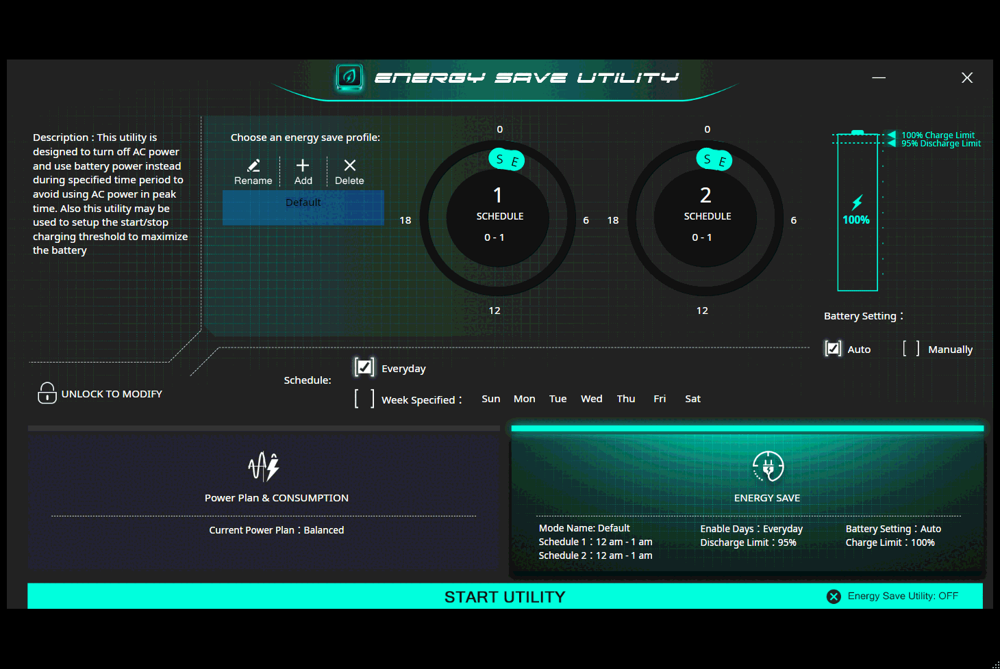

# Ripple Control Center for Linux

An unofficial Linux port of the Clevo / Ripple "Control Center 3.0" laptop suite. It controls fans,
performance modes and the keyboard backlight on the Clevo NH5x_NH7xHP through the
firmware's ACPI interface, and re-creates the nine Windows apps with Avalonia (.NET 10).

Status: early. The kernel module and the CLI are verified on real hardware. The GUI apps and the daemon are
so far tested against a built-in simulator only. See [docs/roadmap.md](docs/roadmap.md).

## Supported hardware
Only the Clevo NH5x_NH7xHP (i7-11800H, RTX 3060, BIOS 1.07.09I, two fans) has been tested. Other Clevo
models that use the same `\_SB.DCHU._DSM` firmware interface may partly work, but nothing is known about them,
and wrong firmware calls on a different model could misbehave. Do not run it elsewhere unless you accept that risk.

## Screenshots
| | |
|---|---|
|  |  |
|  |  |

One screenshot per app is in [docs/screenshots/](docs/screenshots/). These are rendered headlessly against the simulator.

## Apps and status
"Hardware-verified" means exercised on the real laptop. Everything marked "simulator only" renders and sends the
expected commands to the mock backend but has not run against real hardware.

| app | purpose | status |
|---|---|---|
| ControlCenter30 | launcher and power modes | simulator only |
| FanSpeedSetting | fan monitor, fan modes, custom curve, anti-dust | simulator only (the same commands via `ripplectl` are hardware-verified, except custom curve write) |
| LedKeyboardSetting | keyboard backlight colour and brightness | simulator only; per-key and light-bar I/O stubbed |
| EnergySave | power plans, energy-save schedule | simulator only |
| BatteryUtility | battery refresh / health diagnosis | simulator only |
| CPUOC | CPU overclocking UI | simulator only; writes locked and not wired |
| GPUOverclocking | GPU overclocking UI | simulator only; writes locked and stubbed |
| Flexikey | key/mouse remapping and macros | simulator only; macros saved but not applied |
| FnKey | on-screen popups for Fn keys | simulator only; not fed by real Fn key events |

Per-app details and known gaps: [docs/apps/](docs/apps/).

## Architecture
```mermaid
flowchart TD
    A[Avalonia apps<br/>unprivileged] -->|JSON lines over<br/>/run/ripple-cc/ccd.sock| B[ripple-ccd<br/>root daemon]
    C[ripplectl CLI<br/>run as root] -->|ioctl| D
    B -->|ioctl| D[/dev/ripple_dchu]
    D --> E[ripple_dchu kernel module]
    E -->|_SB.DCHU._DSM| F[ACPI / WMI firmware]
    A -.->|no daemon| M[MockBackend simulator]
```
The protocol the firmware speaks is described in [docs/protocol.md](docs/protocol.md).

## Requirements
Arch Linux (other distributions should work but are untested):
- `dotnet-sdk` 10
- `dkms` and `linux-headers` matching your kernel
- `python`
- optional: `power-profiles-daemon` (EnergySave power plans), `nvidia-utils` (GPU readings)
- keyboard backlight uses the `tuxedo_keyboard` LED (`/sys/class/leds/rgb:kbd_backlight`) from tuxedo-drivers

## Build and install
```sh
scripts/build.sh            # as your normal user; publishes every app to dist/<App>/
sudo scripts/install.sh     # DKMS module, daemon and systemd unit, apps under /opt/ripple-cc, menu entries
```
A reboot is needed if a newer kernel than the running one is installed (the module is built for all installed
kernels). After install, start the launcher from the application menu or run `ripple-controlcenter30`.

Uninstall:
```sh
sudo scripts/uninstall.sh
```

## ripplectl
`ripplectl` talks to `/dev/ripple_dchu` directly and needs root.

```sh
sudo ripplectl status [--watch SEC]     # fan rpm, duty, temperatures
sudo ripplectl table [--raw]            # firmware fan curves
sudo ripplectl perf quiet|powersave|performance|entertainment [--turbo-fan] [--dtt]
sudo ripplectl fan auto|max|maxq|custom
sudo ripplectl curve --cpu T2:D2,T3:D3 ...    # write a custom fan curve (see --help; --force)
sudo ripplectl kbd --color RRGGBB --brightness 0-100
sudo ripplectl raw FUNC [ARG] [--buf HEX]     # raw DCHU call (expert)
```
Use `ripplectl <command> --help` for details.

## Safety
- Use at your own risk. This software writes to laptop firmware. Wrong values can cause unexpected fan,
  thermal or power behaviour. There is no warranty (see the license).
- Fan writes are real: `fan max`, `fan custom` and curve writes change what the firmware does. The firmware
  reverts to its automatic fan mode on reboot; the daemon re-applies the last mode, performance mode and curve at start.
- FanSpeedSetting writes fan defaults and a default curve to the firmware on its first launch.
- CPU and GPU overclock writes are locked by default and are in any case not wired to a real back-end yet.
  The daemon refuses them unless `/etc/ripple-cc/oc-unlocked` exists. Do not create that file unless you know what
  you are doing.
- The custom fan curve write has not been tested on real hardware.

## Development
See [CONTRIBUTING.md](CONTRIBUTING.md) and [docs/](docs/README.md).

## License
GPL-2.0, see [LICENSE](LICENSE).

## Disclaimer
This is an unofficial project. It is not affiliated with, endorsed by or supported by Clevo or Ripple.
All trademarks, product names and artwork belong to their respective owners. The firmware protocol was
determined by analysing software and firmware of one machine, for interoperability.
