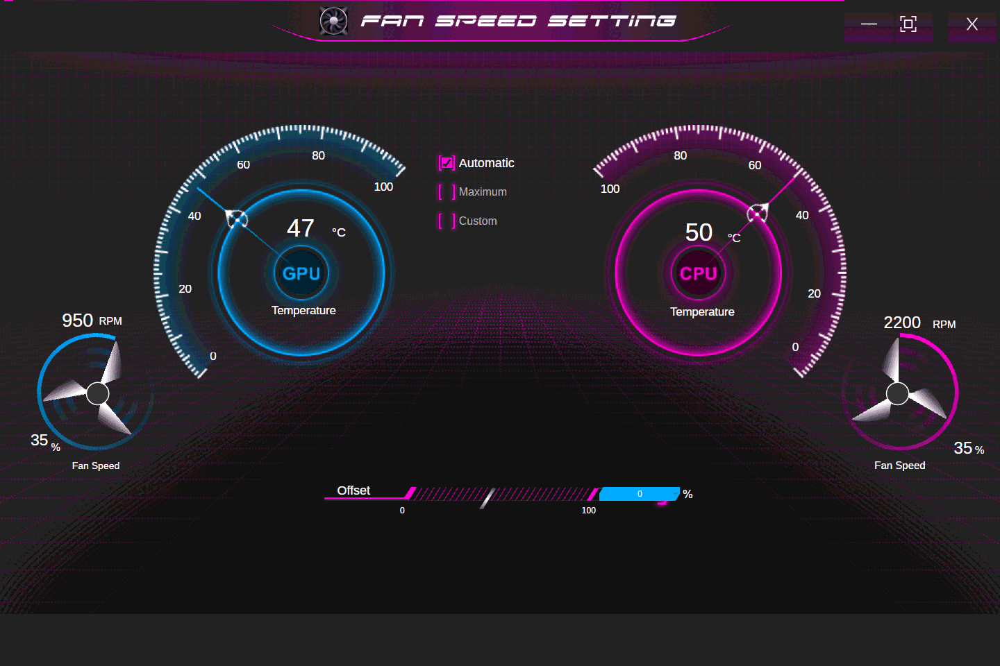
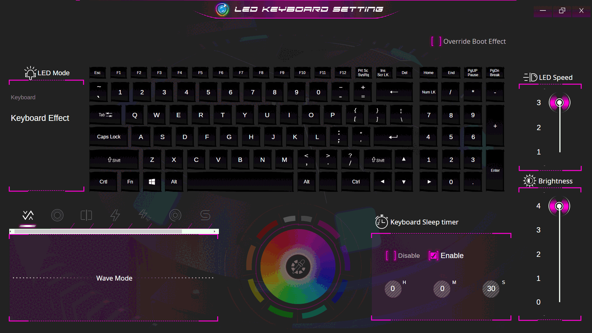
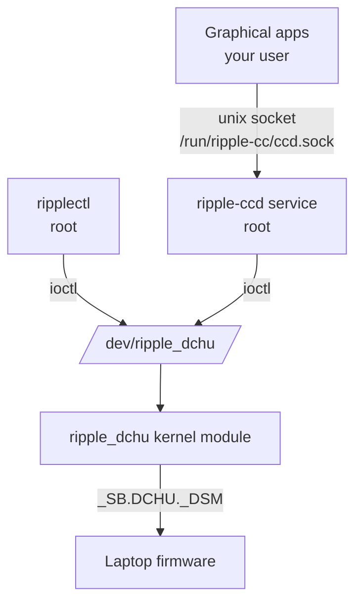

# Clevo Control Center for Linux

[](https://github.com/sawongam/clevo-control-center-linux/actions/workflows/ci.yml)
[](LICENSE)

An unofficial Linux port of Control Center 3.0, the Windows utility that ships with Clevo laptops and their
rebrands. It reads fan speeds and temperatures, switches fan and performance modes, edits fan curves and sets the
keyboard backlight, through the same firmware interface the Windows software uses.

The short name of the project is `ripple-cc`. It started on a Clevo NH5x_NH7xHP, and
that name is used for the package, the commands and the install paths.


## Status

This is early software, and only part of it has run on real hardware.

| Part | State |
|---|---|
| Kernel module `ripple_dchu` | Tested on hardware |
| `ripplectl`: fan and temperature readings, fan modes, performance modes | Tested on hardware |
| `ripplectl curve`: custom fan curve write | Not tested on hardware |
| `ripple-ccd` service | Tested against the simulator only |
| Graphical apps | Tested against the simulator only |
| CPU and GPU overclocking | Interface only. Writes are locked and not connected to a back-end |

No release has been tagged yet, so for now the way to install is [from source](#from-source).
[docs/roadmap.md](docs/roadmap.md) has the details and the list of open work.

## Supported hardware

One machine has been tested: the Clevo NH5x_NH7xHP (Intel i7-11800H, RTX 3060, two fans, BIOS 1.07.09).
It is sold under several brand names.

Other Clevo models expose the same ACPI device (`CLV0001`, method `\_SB.DCHU._DSM`), and the original software
carries code paths for many of them, which the port keeps. None of those have been tested. A firmware call that is
harmless on one board can do something else on another, so try a different model only if you accept that risk, and
please [report what you find](https://github.com/sawongam/clevo-control-center-linux/issues/new?template=hardware-report.yml).

## What is included

Control Center opens as one window. Its tiles open the other tools, as on Windows.

| Tool | What it does |
|---|---|
| Control Center | Launcher and power modes (quiet, power saving, performance, entertainment) |
| Fan Speed Setting | Fan and temperature gauges, fan modes, custom fan curve, anti-dust |
| LED Keyboard | Keyboard backlight colour, brightness and sleep timer |
| Energy Save | Power plans and a scheduled energy-saving mode |
| Battery Utility | Battery refresh and health diagnosis |
| Flexikey | Key and mouse remapping, macros. Macros are saved but not applied yet |
| CPU Overclocking, GPU Overclocking | Monitoring works. Writes are locked |
| Fn key OSD | On-screen popups for Fn keys. Not connected to real key events yet |

| | |
|---|---|
|  |  |

There is also `ripplectl`, a command line tool that needs neither the service nor a desktop.

## Install

All three ways install the same things: the kernel module (built by DKMS, so it survives kernel updates), the
`ripple-ccd` service, `ripplectl`, and the apps under `/opt/ripple-cc` with one "Control Center" entry in the
application menu.

You need the headers for your running kernel (`linux-headers` on Arch, `linux-headers-$(uname -r)` on Debian and
Ubuntu) so that DKMS can build the module.

### Debian and Ubuntu

Download `ripple-cc_<version>_amd64.deb` from the
[releases page](https://github.com/sawongam/clevo-control-center-linux/releases), then:

```sh
sudo apt install ./ripple-cc_*_amd64.deb
```

### Arch Linux

Download `ripple-cc-<version>-x86_64.pkg.tar.zst` from the releases page and install it with `sudo pacman -U`, or
build it yourself from [packaging/arch/PKGBUILD](packaging/arch/PKGBUILD). Then start the service:

```sh
sudo systemctl enable --now ripple-ccd
```

### Any distribution

Download `ripple-cc-<version>-linux-x64.tar.gz` from the releases page. It contains the built apps with the .NET
runtime included. You need `dkms`, `python3`, the Liberation and Noto fonts, and systemd.

```sh
tar xf ripple-cc-*-linux-x64.tar.gz
cd ripple-cc-*-linux-x64
sudo scripts/install.sh
```

### From source

Requirements: .NET SDK 10, `dkms`, kernel headers, `python3`, and the Liberation and Noto fonts.
On Arch: `sudo pacman -S --needed dotnet-sdk dkms linux-headers python ttf-liberation noto-fonts`.

```sh
git clone https://github.com/sawongam/clevo-control-center-linux.git
cd clevo-control-center-linux
scripts/build.sh            # as your normal user
sudo scripts/install.sh
```

If the installed kernel is newer than the running one, the module is built for the new kernel and the installer
asks you to reboot.

### Uninstall

Remove the package with your package manager, or run `sudo scripts/uninstall.sh` if you used the install script.
Settings in `/var/lib/ripple-cc`, `/etc/ripple-cc` and `~/.config/ripple-cc` are kept.

## Usage

Open **Control Center** from the application menu, or run `ripple-cc`.

`ripplectl` talks to the kernel module directly and needs root:

```sh
sudo ripplectl status [--watch SEC]             # fan rpm, duty and temperatures
sudo ripplectl table                            # fan curves stored in the firmware
sudo ripplectl perf quiet|powersave|performance|entertainment
sudo ripplectl fan auto|max|maxq|custom
sudo ripplectl curve --cpu T2:D2,T3:D3          # write a custom fan curve, see --help
sudo ripplectl kbd --color RRGGBB --brightness 0-100
```

`ripplectl kbd` uses the keyboard LED from [tuxedo-drivers](https://github.com/tuxedocomputers/tuxedo-drivers)
(`/sys/class/leds/rgb:kbd_backlight`). Optional extras: `power-profiles-daemon` for the power plans in Energy Save,
and `nvidia-utils` for GPU readings.

## How it works



On Windows the apps reach the firmware through a service and a driver that evaluates one ACPI method.
`ripple_dchu` is a small kernel module that exposes that method as `/dev/ripple_dchu`. The `ripple-ccd` service
owns the device, so the apps run without root. It also stores settings and applies the last fan mode,
performance mode and fan curve again at boot, because the firmware forgets them. The apps are the original
.NET programs ported from WPF to [Avalonia](https://avaloniaui.net/).

The decoded command set and the hardware test log are in [docs/protocol.md](docs/protocol.md).

## Safety

- This software sends commands to your laptop's firmware. Wrong values can cause unexpected fan, thermal or power
  behaviour. There is no warranty: see the [license](LICENSE).
- Fan writes are real. `fan max`, `fan custom` and curve writes change what the firmware does until the next
  reboot, and the service then applies your last settings again.
- Fan Speed Setting writes the fan defaults and a default curve to the firmware the first time it starts, as the
  Windows app does.
- CPU and GPU overclock writes are refused unless `/etc/ripple-cc/oc-unlocked` exists. They are not connected to a
  real back-end in any case. Leave that file alone unless you are developing that part.

## Documentation

- [docs/roadmap.md](docs/roadmap.md): what works, what does not, and the open work
- [docs/protocol.md](docs/protocol.md): the firmware protocol
- [docs/porting.md](docs/porting.md): how the Windows apps were ported, and the rules for changing them
- [docs/apps/](docs/apps/): notes for each app
- [CONTRIBUTING.md](CONTRIBUTING.md): development setup and how to send changes

Hardware reports from other Clevo models are the most useful contribution right now.

## License and disclaimer

The code in this repository is licensed under [GPL-2.0](LICENSE).

This project is not affiliated with, endorsed by or supported by Clevo or Ripple. The apps are ports of the
vendor's Control Center 3.0 and include its artwork, which remains the property of its owners, as do all
trademarks and product names. The firmware protocol was worked out by analysing the software and firmware of one
machine, for interoperability.
